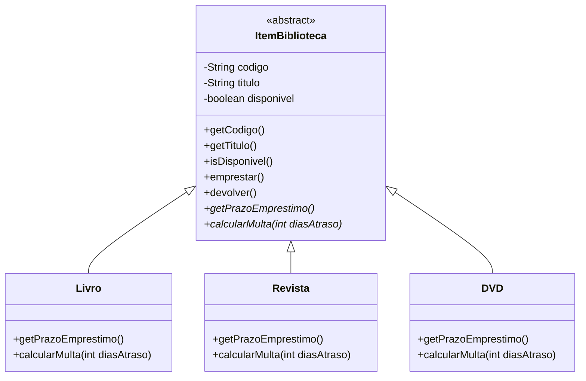
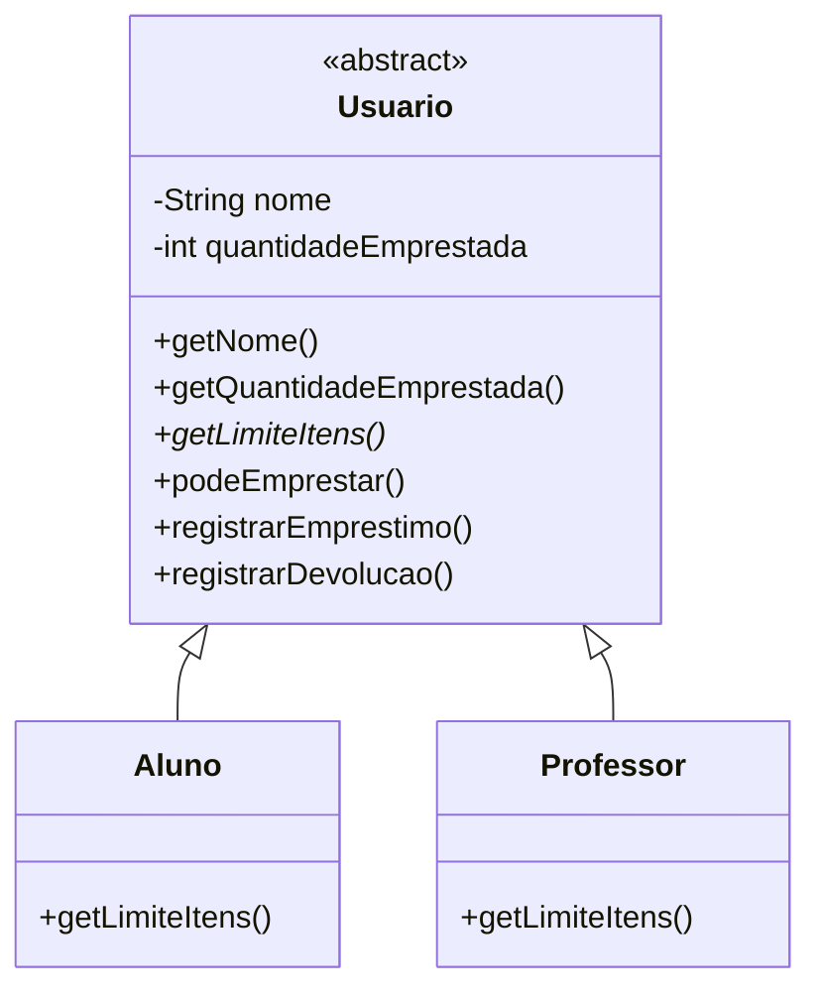
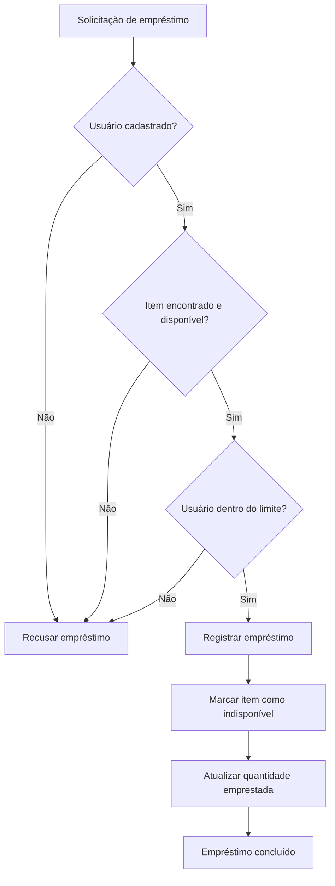
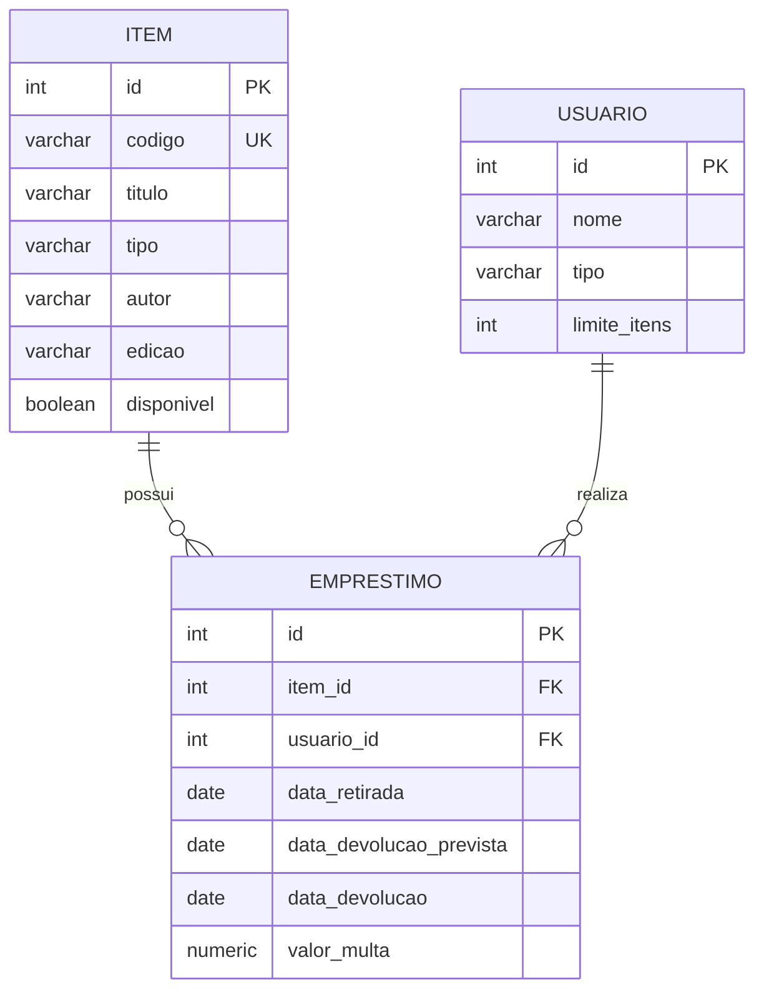

# 📚 Sistema de Biblioteca | Java + PostgreSQL

<div align="center">

**Java • Programação Orientada a Objetos • PostgreSQL • SQL • Maven**

Sistema de gerenciamento de biblioteca desenvolvido como atividade prática do **Bootcamp Dev Full Stack da +PraTi**.


</div>

---

## 📖 Sobre o projeto

O **Sistema de Biblioteca** foi desenvolvido como parte de uma lista de exercícios do **Bootcamp Dev Full Stack da +PraTi**, com o objetivo de consolidar conhecimentos em **Programação Orientada a Objetos (POO) com Java** e **Banco de Dados PostgreSQL**.

O projeto simula operações de gerenciamento de uma biblioteca, contemplando o cadastro de itens e usuários, o controle de empréstimos e devoluções, a aplicação de limites por categoria de usuário e o cálculo de multas por atraso.

A atividade foi organizada em três exercícios:

| Exercício | Descrição | Conceitos aplicados |
|---|---|---|
| **01 — Java e POO** | Implementação do sistema de biblioteca | Abstração, herança, encapsulamento e polimorfismo |
| **02 — Banco de Dados** | Modelagem e criação das tabelas | SQL, chaves e integridade referencial |
| **03 — Consultas SQL** | Recuperação e análise dos registros | JOIN, GROUP BY, SUM e filtros |

> [!NOTE]
> A aplicação Java e o banco de dados PostgreSQL foram desenvolvidos como exercícios independentes, conforme a proposta da atividade. Não há integração JDBC ou persistência automática entre eles.

---

## 🚀 Funcionalidades

| Módulo | Funcionalidades |
|---|---|
| 📚 **Acervo** | Cadastro, listagem e controle de disponibilidade de livros e revistas |
| 👥 **Usuários** | Cadastro de alunos e professores com limites específicos |
| 🔄 **Empréstimos** | Validação da disponibilidade e do limite de itens por usuário |
| 📥 **Devoluções** | Registro da devolução e atualização da disponibilidade |
| 💰 **Multas** | Cálculo de multas conforme o tipo de item e os dias de atraso |
| 🗄️ **Banco de Dados** | Criação de tabelas, relacionamentos e inserção de registros |
| 🔎 **Consultas SQL** | Listagem do acervo, empréstimos em aberto, multas e itens nunca emprestados |

---

## 🛠️ Tecnologias utilizadas

| Tecnologia | Finalidade |
|---|---|
| **Java 23** | Desenvolvimento da aplicação |
| **POO** | Modelagem das entidades e regras de negócio |
| **Maven** | Gerenciamento e estruturação do projeto |
| **PostgreSQL** | Banco de dados relacional |
| **SQL** | Definição, manipulação e consulta dos dados |
| **IntelliJ IDEA** | Ambiente de desenvolvimento |
| **pgAdmin 4** | Administração do banco de dados |
| **Git e GitHub** | Versionamento e hospedagem do projeto |

---

## 🏗️ Arquitetura do projeto

A aplicação foi organizada em pacotes para separar as entidades, as regras de negócio e a execução dos cenários de teste.

```text
sistema-biblioteca/
│
├── .mvn/
│
├── src/
│   └── main/
│       └── java/
│           └── br/
│               └── com/
│                   └── biblioteca/
│                       │
│                       ├── model/
│                       │   ├── ItemBiblioteca.java
│                       │   ├── Livro.java
│                       │   ├── Revista.java
│                       │   ├── DVD.java
│                       │   ├── Usuario.java
│                       │   ├── Aluno.java
│                       │   └── Professor.java
│                       │
│                       ├── service/
│                       │   └── Biblioteca.java
│                       │
│                       └── app/
│                           └── Main.java
│
├── sql/
│   ├── 01_criar_tabelas.sql
│   ├── 02_inserir_dados.sql
│   └── 03_consultas.sql
│
├── .gitignore
├── pom.xml
└── README.md
```

### Organização dos pacotes

| Pacote | Responsabilidade |
|---|---|
| `model` | Classes abstratas e entidades do sistema |
| `service` | Gerenciamento do acervo, empréstimos e devoluções |
| `app` | Execução da aplicação e demonstração dos cenários de teste |
| `sql` | Scripts de criação, inserção e consulta do banco de dados |

A classe `Biblioteca` utiliza **arrays de tamanho fixo** para armazenar itens, usuários e responsáveis pelos empréstimos, atendendo aos requisitos da atividade.

---

## 🧩 Programação Orientada a Objetos

A implementação utiliza os quatro pilares da POO: **abstração, encapsulamento, herança e polimorfismo**.

### 📚 Hierarquia dos itens

A classe abstrata `ItemBiblioteca` define os atributos e comportamentos comuns aos itens do acervo.

As subclasses implementam suas próprias regras de prazo e multa.



### 👥 Hierarquia dos usuários

A classe abstrata `Usuario` concentra os dados e comportamentos compartilhados pelos usuários.

Cada subclasse define seu próprio limite de empréstimos.



### Conceitos aplicados

| Conceito | Aplicação no projeto |
|---|---|
| **Abstração** | Classes abstratas `ItemBiblioteca` e `Usuario` |
| **Herança** | Especialização de itens e usuários |
| **Encapsulamento** | Atributos privados e operações controladas |
| **Polimorfismo** | Implementação de prazos, multas e limites específicos |

### Exemplo de polimorfismo

```java
ItemBiblioteca livro = new Livro("L001", "Clean Code");
ItemBiblioteca revista = new Revista("R001", "Ciência Hoje");

System.out.println(livro.getPrazoEmprestimo());   // 14
System.out.println(revista.getPrazoEmprestimo()); // 7
```

Embora os objetos sejam referenciados pelo mesmo tipo abstrato, cada um executa a implementação correspondente à sua classe.

Isso permite adicionar novas categorias de itens sem modificar os métodos existentes da classe `Biblioteca`.

---

## 📋 Regras de negócio

### 📚 Prazos e multas

| Tipo de item | Prazo | Multa diária |
|---|---|---|
| Livro | 14 dias | R$ 0,50 |
| Revista | 7 dias | R$ 1,00 |
| DVD (teste adicional) | 5 dias | R$ 2,00 |

**Cálculo da multa:**

```text
Multa = Dias de atraso × Valor diário
```

Exemplo:

```text
Revista devolvida com 3 dias de atraso

3 × R$ 1,00 = R$ 3,00
```

Não há cobrança de multa quando o item é devolvido sem atraso.

> [!NOTE]
> A classe `DVD` foi adicionada como teste de extensibilidade e polimorfismo. Suas regras de empréstimo e multa são ilustrativas.

### 👥 Limites de empréstimos

| Tipo de usuário | Limite simultâneo |
|---|---|
| Aluno | 3 itens |
| Professor | 5 itens |

O sistema impede novos empréstimos quando o usuário atinge seu limite.

### 🔄 Fluxo de empréstimo



Na devolução, o sistema calcula a multa, libera o item e atualiza a quantidade de empréstimos do usuário responsável.

---

## 🗃️ Banco de dados PostgreSQL

O banco de dados foi modelado com três tabelas principais:

- `item`: informações dos livros e revistas.
- `usuario`: informações dos alunos e professores.
- `emprestimo`: histórico de empréstimos e devoluções.

### Modelo Entidade-Relacionamento



### Relacionamentos

| Relacionamento | Cardinalidade |
|---|---|
| `usuario` → `emprestimo` | Um para muitos (1:N) |
| `item` → `emprestimo` | Um para muitos (1:N) |

Cada empréstimo está associado a um usuário e a um item.

As chaves estrangeiras garantem a integridade referencial dos registros.

### Restrições de integridade

O banco utiliza:

- `PRIMARY KEY`: identificação única dos registros.
- `FOREIGN KEY`: relacionamento entre tabelas.
- `NOT NULL`: obrigatoriedade de preenchimento.
- `UNIQUE`: prevenção de códigos duplicados.
- `CHECK`: validação dos tipos e limites permitidos.
- `DEFAULT`: definição de valores padrão.

Os identificadores são gerados automaticamente utilizando `GENERATED ALWAYS AS IDENTITY`.

---

## 🔎 Consultas SQL

O projeto contempla quatro consultas para recuperação e análise dos dados cadastrados.

### 1. Listar todo o acervo

Exibe o código, título, tipo e disponibilidade dos itens.

```sql
SELECT
    codigo,
    titulo,
    tipo,
    disponivel
FROM item
ORDER BY codigo;
```

### 2. Listar empréstimos em aberto

Relaciona os empréstimos aos respectivos usuários e itens, retornando apenas os registros sem data de devolução.

```sql
SELECT
    u.nome AS usuario,
    i.titulo AS item,
    e.data_retirada,
    e.data_devolucao_prevista
FROM emprestimo e
INNER JOIN usuario u
    ON e.usuario_id = u.id
INNER JOIN item i
    ON e.item_id = i.id
WHERE e.data_devolucao IS NULL
ORDER BY e.data_retirada;
```

### 3. Calcular multas por usuário

Agrupa os empréstimos por usuário e soma os valores das multas registradas.

```sql
SELECT
    u.nome AS usuario,
    COALESCE(SUM(e.valor_multa), 0) AS total_multas
FROM usuario u
LEFT JOIN emprestimo e
    ON u.id = e.usuario_id
GROUP BY u.id, u.nome
ORDER BY u.nome;
```

### 4. Listar itens nunca emprestados

Identifica os itens que não possuem registros associados na tabela de empréstimos.

```sql
SELECT
    i.codigo,
    i.titulo,
    i.tipo
FROM item i
LEFT JOIN emprestimo e
    ON i.id = e.item_id
WHERE e.id IS NULL
ORDER BY i.codigo;
```

### Conceitos SQL utilizados

| Comando | Finalidade |
|---|---|
| `SELECT` | Consultar informações |
| `INNER JOIN` | Relacionar registros correspondentes |
| `LEFT JOIN` | Incluir registros sem correspondência |
| `WHERE` | Filtrar resultados |
| `IS NULL` | Identificar valores ausentes |
| `GROUP BY` | Agrupar registros |
| `SUM()` | Somar valores |
| `COALESCE()` | Substituir resultados nulos |
| `ORDER BY` | Ordenar resultados |

---

## 💻 Como executar o projeto

### Pré-requisitos

Para executar a aplicação e os scripts SQL, é necessário ter:

- Java JDK 23.
- IntelliJ IDEA ou outra IDE compatível.
- Maven.
- PostgreSQL.
- pgAdmin 4.
- Git.

### 1. Clonar o repositório

```bash
git clone https://github.com/mdouracyfreire/sistema-biblioteca.git
```

Acesse o diretório:

```bash
cd sistema-biblioteca
```


### 2. Executar a aplicação Java

Abra o projeto no **IntelliJ IDEA** e aguarde o carregamento das configurações Maven.

Localize a classe:

```text
src/main/java/br/com/biblioteca/app/Main.java
```

Execute o método `main()` utilizando a opção **Run 'Main.main()'**.

A aplicação apresentará no console os cenários de cadastro, empréstimo, devolução, validação de limites e cálculo de multas.

### 3. Configurar o PostgreSQL

Abra o pgAdmin 4 e crie o banco de dados:

```sql
CREATE DATABASE biblioteca_db;
```

Conecte-se ao banco `biblioteca_db` e abra o **Query Tool**.

Execute os scripts da pasta `sql` na seguinte ordem:

| Ordem | Arquivo | Finalidade |
|---|---|---|
| 1 | `01_criar_tabelas.sql` | Criar tabelas e relacionamentos |
| 2 | `02_inserir_dados.sql` | Inserir registros de teste |
| 3 | `03_consultas.sql` | Executar as consultas solicitadas |

> [!IMPORTANT]
> Os scripts de criação e inserção foram preparados para uma base inicialmente vazia. Evite executá-los novamente sem verificar os registros existentes.

---

## 🧪 Testes e validações

Foram realizados testes de execução para verificar as principais regras de negócio.

| Cenário | Resultado esperado |
|---|---|
| Cadastro de item | Item adicionado ao acervo |
| Cadastro de usuário | Usuário registrado |
| Empréstimo de item disponível | Operação autorizada |
| Empréstimo de item indisponível | Operação recusada |
| Usuário com limite atingido | Novo empréstimo recusado |
| Devolução de item | Disponibilidade atualizada |
| Devolução com atraso | Multa calculada |
| Inclusão de nova categoria | Funcionamento sem alterar a classe `Biblioteca` |

### Teste adicional de polimorfismo

Foi implementada a classe `DVD`, herdando de `ItemBiblioteca`, para verificar a extensibilidade da solução.

A nova categoria possui suas próprias regras de prazo e multa e pode ser utilizada pelos métodos existentes de gerenciamento do acervo.

Esse teste demonstra a aplicação do **Princípio Aberto/Fechado (Open/Closed Principle)**, no qual novas funcionalidades podem ser adicionadas por extensão, sem necessidade de modificar o comportamento das classes já existentes.

> Os cenários foram executados pela classe `Main`, utilizando a saída do console para verificar os resultados.

---

## 📚 Aprendizados

Durante o desenvolvimento deste projeto, foram praticados conceitos importantes de desenvolvimento de software, como:

- Programação Orientada a Objetos em Java.
- Abstração, herança, encapsulamento e polimorfismo.
- Criação e implementação de classes e métodos abstratos.
- Separação de responsabilidades entre classes e pacotes.
- Aplicação de regras de negócio.
- Manipulação de arrays de tamanho fixo.
- Tratamento de operações inválidas.
- Extensibilidade de classes.
- Modelagem de bancos de dados relacionais.
- Criação de tabelas e relacionamentos.
- Aplicação de restrições de integridade.
- Manipulação e consulta de registros com SQL.
- Utilização de junções, filtros e funções de agregação.
- Versionamento de código com Git e Conventional Commits.

O projeto contribuiu para consolidar conhecimentos de **Java, POO e PostgreSQL**, reforçando a importância da organização do código, da reutilização de comportamentos e da integridade dos dados.

---

## 🎓 Contexto acadêmico

Este projeto foi desenvolvido para fins educacionais, como parte de uma **lista de exercícios do Bootcamp Dev Full Stack da +PraTi**.

A atividade teve como objetivo reforçar os fundamentos da Programação Orientada a Objetos com Java e da modelagem e manipulação de bancos de dados relacionais com PostgreSQL.

O repositório está disponível para consulta e como referência de estudo, demonstrando os conhecimentos adquiridos e aplicados durante a formação.

---

## 👩‍💻 Autora

<div align="center">

Desenvolvido com 💛 por **Douracy Freire**

<br>

<a href="https://github.com/mdouracyfreire">
  
</a>

<a href="https://www.linkedin.com/in/douracy/">
  
</a>

</div>

---

<div align="center">

### 📚 Sistema de Biblioteca

**Java • Programação Orientada a Objetos • PostgreSQL • SQL • Maven**

*Projeto acadêmico desenvolvido com foco em aprendizagem, boas práticas e evolução técnica.*

**Bootcamp Dev Full Stack | +PraTi**

</div>
